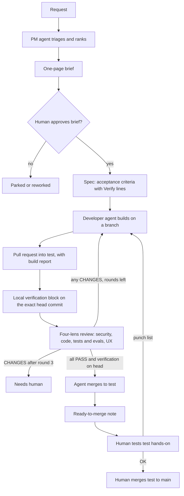

# The software factory process

This document defines how a change moves from an idea to the `main` branch. It is tool-neutral. The examples assume Git, a hosted Git service with pull requests (for example GitHub) and a CI service, but any equivalent works.

## 1. Principles

1. **One file per step.** Every step writes one markdown file. Its first line is a machine-readable verdict, so the state of a job can be read at a glance and checked automatically.
2. **Testable acceptance criteria.** Every criterion is one observable behaviour plus a "Verify" line that says exactly how to check it, using only the repo.
3. **Evidence or it did not happen.** Only reviewer evidence and the Local verification block count. The builder's own report is a list of claims to check, not proof.
4. **Independent review.** The review is done by runs that did not write the code. The Reviewer runs the branch once and records evidence; each lens then judges only the diff, the acceptance checklist with that evidence, and its own instructions.
5. **Capped rework.** At most three review rounds, then a human decides.
6. **A human owns `main`.** Agents may merge to `test`. Only the human merges to `main`.

## 2. Roles

| Role | Kind | Responsibilities |
|---|---|---|
| Human approver | Person | Sets direction, approves briefs and specs, creates repos, holds secrets and permissions, tests `test` hands-on, decides every flagged item, and is the only one who merges to `main`. |
| PM agent | AI agent | Triages and ranks requests, writes the brief and the spec with acceptance criteria, spot-checks evidence, and writes the ready-to-merge note. |
| Developer agent | AI agent | Builds the change locally on the shared Linux box (the standard build path; a Cursor cloud agent is optional, used only if cloud agents are working), opens the pull request with a build report, and handles rework. |
| Reviewer | AI agent run, independent of the builder | Runs the branch once for evidence, runs the four lenses in isolation, and combines one verdict per lens. |
| CI | Automation | Builds and publishes images, deploys and releases. It does not run tests on pull requests; validation is local (`standards/ci-minutes.md`). |

### Where builds run (2026-10-31)

Local builds on the box are the standard way we build. The developer agent clones or reuses a checkout on the shared Linux box, builds, and verifies there. Cursor cloud agents are optional: use one only if cloud agents are working again and the task suits it, and its work still goes through the same box-local verification before push and merge.

**Box-local build rule (Mike, 2026-10-31 retro):** `verify-local.sh` plus the Playwright suite run on the box before every push.

## 3. How a job flows

1. **Request.** An idea or request comes in.
2. **Triage.** The PM agent ranks it against the current goals. Off-goal items are parked, not deleted, with a note on what would bring them back.
3. **Brief.** One page: the problem, who it is for, what done looks like. Nothing is ready to build until the human approves the brief.
4. **Spec.** The PM agent writes the spec from `templates/spec.md`. Every acceptance criterion has a Verify line. The spec must pass the Definition of Ready (in the template) before build starts.
5. **Build.** The developer agent builds on a branch in a local checkout on the box (primary; cloud agents are optional), makes the simplest change that fully meets the spec, runs the repo's checks, runs `scripts/verify-local.sh` plus the Playwright suite on the box before every push, and opens a pull request into `test`. The pull request description starts with a build report from `templates/build-report.md`.
6. **Local verification.** The developer agent runs `scripts/verify-local.sh` (lint, types, unit, functional tests, the Playwright e2e suite under `tests/e2e/`, security scans) on the exact head commit and adds the Local verification block to the pull request. No stacked pull requests: each one targets `test` and gets a fresh block.
7. **Review.** An independent reviewer runs the four-lens review from `templates/review.md` and writes one verdict per lens.
8. **Rework.** Any CHANGES verdict sends the pull request back to the builder with the review file. See section 5.
9. **Merge to `test`.** When all four lenses PASS and the Local verification block is all PASS on the same head commit, an agent merges the pull request into `test`. No human is needed for this step, unless an always-flagged item applies (section 7).
10. **Ready-to-merge note.** The PM agent writes a short note from `templates/ready-to-merge.md`: what it is, how to try it, the checks, and anything to look at.
11. **Human check.** The human pulls `test`, tries it, and either sends a punch list back to step 5 or approves.
12. **Merge to `main`.** Only the human merges `test` into `main`. Releases and publishing each need the human's OK.

## 4. Gates

| Gate | Passes when | Owner |
|---|---|---|
| Brief approval | The human approves the brief | Human |
| Definition of Ready | Every criterion has a Verify line, scope and assumptions are written, expected flags are ticked | PM agent |
| Build report | First line is `STATUS: READY`, with evidence per criterion | Developer agent |
| Local verification | Block in the pull request, no FAIL, on the exact head commit | Developer agent |
| Four-lens review | All four lenses `VERDICT: PASS` | Reviewer |
| Merge to `test` | Review PASS and Local verification on the same commit, no unresolved flags | Developer agent |
| Merge to `main` | The human has tested `test` and approves | Human |

### Playwright e2e rule (2026-10-30)

All user-facing testing uses Playwright. Core and every bot repo keep a committed suite under `tests/e2e/`, run on desktop and mobile with the stub LLM by default, plus one opt-in live-provider smoke test (marker or env flag, cheap model, keys never logged). Every failure saves a screenshot and a trace. `verify-local.sh` runs the suite and it must PASS before any merge to `test`; the Local verification block lists the suite result (passes per project) and the head SHA. The Reviewer's evidence run includes the suite, and any new user-facing behaviour adds or updates its e2e tests in the same pull request. Full text: `standards/definition-of-done.md`.

## 5. The four review lenses

Each lens gets exactly one line, `VERDICT: PASS` or `VERDICT: CHANGES`, followed by findings (`path:line`, problem, impact, fix) and non-blocking notes.

1. **Security.** Auth on new endpoints, input validation, injection and XSS, secrets in commits, data exposure in logs and pages, outbound calls, new dependencies, exposed ports.
2. **Code.** Does what the spec asks and nothing more, handles errors and edge cases, reuses existing patterns, follows the repo's conventions, updates docs.
3. **Tests and evals.** Every criterion has a test or a reproducible check, tests fail without the change, tests run in the local verification, no network or paid calls in tests.
4. **UX.** The flow works with no dead ends, loading, empty and error states are useful, copy is short and plain, keyboard and small-screen use work. A change with nothing user-facing gets PASS with a note.

Lens isolation (wave 1, T5):

- First, outside the lens runs, the Reviewer runs the branch and the app once and records pass/fail evidence for each item on the spec's acceptance checklist.
- The Reviewer then runs each of the four lenses as its own fresh, stateless run.
- A lens sees only the PR diff, the acceptance checklist with that evidence attached, and its own lens instructions.
- A lens never sees another lens's output.
- The Reviewer combines the verdict only after all four lenses have returned.

Review rules:

- Run it, do not just read it. The Reviewer's evidence run reproduces at least one criterion; lenses judge that evidence and the diff, they do not run the code.
- CHANGES only for real problems: a bug, a spec gap, a failing check, a security issue, or a clear convention break. A failing check is always CHANGES.
- Style preferences and pre-existing issues go under Notes, never Findings.
- From round 2, the evidence run re-checks every earlier finding and records fixed or not fixed with the checklist, so each lens can judge it.

## 6. Rework rules

- A round is complete only when all four lens verdicts exist. Never resume the builder mid-round.
- Any CHANGES verdict starts a rework round. The builder answers every finding in the build report log: what was changed, or why not.
- Maximum **3 rounds** in total (round 1 plus 2 rework rounds).
- If any lens still says CHANGES after round 3, stop. The PM agent writes the ready-to-merge note marked **NOT READY** with the open findings, and the human decides.
- If the builder is blocked (spec contradiction, a decision only the human can make, an environment failure), the build report starts with `STATUS: BLOCKED` and says exactly what is needed.

## 7. Always flagged for the human

These always go to the human, even when every lens passes. The spec lists the ones expected, the build report lists the ones touched, and the ready-to-merge note names them.

- Auth, permissions, signed links, secrets handling
- Money: paid services, API keys, spend, anything that could bill
- Deploy or runtime config: containers, CI workflows, build scripts, ports or bind addresses
- Database schema changes and migrations
- Messages to real people or real providers (email, SMS, voice, outbound webhooks)
- Writing production data
- New dependencies
- Public exposure: making a repo public, publishing packages or images, opening network access
- Safety-critical logic
- Product or business decisions (thresholds, prices, public copy)

Approval rules:

- Nothing is sent, published, paid for, deployed or merged to `main` without the human's explicit OK.
- An agent's say-so is never approval. Only the human's own words count.
- There is no automatic merge to `main`.

## 8. Measure

For every pull request, log outside the notes: agent hours per role, coding-agent runs and model per role, review rounds, and the human's review time. These show whether the factory is working.

## 9. Related files

- `templates/spec.md`, `templates/build-report.md`, `templates/review.md`, `templates/ready-to-merge.md`
- `standards/definition-of-done.md`
- `standards/ci-minutes.md`
