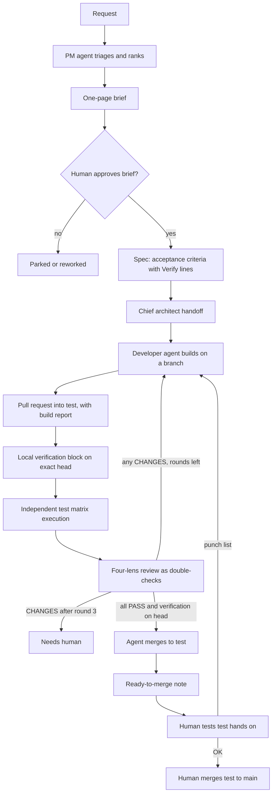

# The software factory process

This document defines how a change moves from an idea to the `main` branch. It is tool-neutral. The examples assume Git, a hosted Git service with pull requests (for example GitHub) and a CI service, but any equivalent works.

## 1. Principles

1. **One file per step.** Every step writes one markdown file. Its first line is a machine-readable verdict, so the state of a job can be read at a glance and checked automatically.
2. **Testable acceptance criteria.** Every criterion is one observable behaviour plus a "Verify" line that says exactly how to check it, using only the repo.
3. **Evidence or it did not happen.** Only reviewer evidence and the Local verification block count. The builder's own report is a list of claims to check, not proof.
4. **Independent review.** The review is done by runs that did not write the code. The Reviewer executes the test matrix once and records evidence; each lens then judges the sanitized bundle (section 5a) in isolation, never seeing another lens's output.
5. **Capped rework.** At most three review rounds, then the human decides.
6. **A human owns `main`.** Agents may merge to `test`. Only the human merges to `main`.

## 2. Roles

| Role | Kind | Responsibilities |
|---|---|---|
| Human | Person | Sets direction, approves briefs and specs, creates repos, holds secrets and permissions, tests `test` hands on, decides every flagged item, resolves escalated disputes, and is the only one who merges to `main`. |
| PM agent | AI agent | Triages and ranks requests, writes the brief and the spec with acceptance criteria, spot-checks evidence, and writes the ready-to-merge note. |
| Chief architect | AI agent | Produces the architect handoff: pins standards, selects reference patterns, preserves the requirements verbatim, and writes the test matrix before the build. |
| Developer agent | AI agent | Builds the change (directly or by launching a coding agent), opens the pull request with a build report (claims only, not evidence), and handles rework. |
| Reviewer | AI agent run, independent of the builder | Executes the test matrix on the exact head and records evidence, runs the four lenses in isolation with the sanitized bundle, combines one verdict per lens, and owns the learning loop after each merge to test. |
| Arbiter | AI agent, on disputed findings only | Makes one evidence-backed challenge to the originating lens, which answers once; has no override authority; escalates unresolved material disputes to the human. |
| CI | Automation | Builds and publishes images, deploys and releases. It does not run tests on pull requests; validation is local (`standards/ci-minutes.md`). |

## 3. How a job flows

1. **Request.** An idea or request comes in.
2. **Triage.** The PM agent ranks it against the current goals. Off-goal items are parked, not deleted, with a note on what would bring them back.
3. **Brief.** One page: the problem, who it is for, what done looks like. Nothing is ready to build until the human approves the brief.
4. **Spec.** The PM agent writes the spec from `templates/spec.md`. Every acceptance criterion has a Verify line and states the expected failure for invalid input. Lessons from `templates/lessons-log.md` are pulled in as known pitfalls (see section 3a for what qualifies). The spec must pass the Definition of Ready before handoff.
5. **Chief architect handoff.** The Chief architect produces the handoff document (`templates/architect-handoff.md`) before the build starts. This pins the applicable standards and profiles, selects reference patterns, preserves the requirements verbatim from the spec, and produces the acceptance-to-test matrix (`templates/test-matrix.md`). Each criterion gets positive, negative, and environment cases, each with an exact command and expected observable behaviour. This is preparation, not a review.
6. **Build.** The Developer agent builds on a branch against the test matrix, makes the simplest change that fully meets the spec, runs the repo's checks, and opens a pull request into `test`. The pull request description starts with a build report from `templates/build-report.md`. The builder's report is claims only, not evidence.
7. **Local verification.** The Developer agent runs `scripts/verify-local.sh` (lint, types, unit, functional tests, the Playwright e2e suite under `tests/e2e/`, security scans) on the exact head commit and adds the Local verification block to the pull request. No stacked pull requests: each one targets `test` and gets a fresh block.
8. **Independent test matrix execution.** Before the four-lens review, the Reviewer executes the test matrix independently on the exact head commit. The Reviewer records the head SHA, environment, and raw outputs in the matrix (`templates/test-matrix.md`, Execution record section). This is the evidence; the builder's report is not. A failed or blocked matrix case is CHANGES.
9. **Four-lens review (double-checks).** The four lenses (Security, Code, Tests and evals, UX/Consistency) run as independent double-checks from `templates/review.md`. Each lens sees only the sanitized bundle (section 5a). Lenses never see the builder's narrative, prior verdicts, or another lens's output. The Tests and evals lens re-executes the negative and environment cases and lists its commands; "Commands run: None" means CHANGES.
10. **Rework.** Any CHANGES verdict sends the pull request back to the builder with the review file. See section 6.
11. **Merge to `test`.** When all four lenses PASS, the Local verification block is all PASS, and the test matrix was executed on the same head commit, an agent merges the pull request into `test`. No human is needed for this step, unless an always-flagged item applies (section 7).
12. **Ready-to-merge note.** The PM agent writes a short note from `templates/ready-to-merge.md`: what it is, how to try it, the checks, and anything to look at.
13. **Human check.** The human pulls `test`, tries it, and either sends a punch list back to step 6 or approves.
14. **Merge to `main`.** Only the human merges `test` into `main`. Releases and publishing each need the human's OK.

## 3a. Learning loop

**Owner:** Reviewer, after each merge to test.

**Trigger:** After a pull request merges to `test`, the Reviewer analyzes the outputs for recurring patterns:

- **Developer mistakes** that could be caught earlier.
- **Reviewer misses** where the four lenses should have caught a defect.
- **Unsupported findings** that were raised but later shown incorrect.

Each lesson is recorded in `templates/lessons-log.md` with source, evidence, disposition, and approval.

**Validated lesson:** A lesson with disposition "accepted" or "applied" whose type is "clarification", or whose type is "new-policy" and has a human approval link.

**Clarifications apply without approval.** Lessons that clarify or test existing approved requirements (type: clarification) can be logged and applied to existing matrix rows, known pitfalls, and tests without the human approving each one. A clarification may only add or tighten, never remove or relax. Do not add factory files, roles, or gates to hold a lesson.

**New policy requires the human's approval.** Lessons that propose new policy or standards changes (type: new-policy) need the human's explicit approval and are never adopted automatically. An agent's say-so is never approval. If the type is unclear, it defaults to new-policy.

## 4. Gates

| Gate | Passes when | Owner |
|---|---|---|
| Brief approval | The human approves the brief | Human |
| Definition of Ready | Every criterion has a Verify line and a negative case, scope and assumptions are written, expected flags are ticked, known pitfalls are pulled in | PM agent |
| Architect handoff | Standards pinned, reference patterns selected, test matrix complete with positive/negative/environment cases | Chief architect |
| Build report | First line is `STATUS: READY`; this is claims only, not evidence | Developer agent |
| Local verification | Block in the pull request, no FAIL, on the exact head commit | Developer agent |
| Matrix execution | Test matrix executed independently on the exact head, with raw outputs recorded | Reviewer |
| Four-lens review | All four lenses `VERDICT: PASS` | Reviewer |
| Merge to `test` | Review PASS, Local verification PASS, and test matrix executed on the same commit, no unresolved flags | Developer agent |
| Merge to `main` | The human has tested `test` and approves | Human |

### Playwright e2e

Standing rule: `standards/definition-of-done.md`. For this factory (docs and templates only, no application runtime) browser e2e is recorded as SKIP with rationale N/A. That is not a PASS of an e2e suite and not a failed-case waiver. Security scans (gitleaks, semgrep) must still be installed, execute, and pass. Every other applicable check remains required. `--allow-missing` is not acceptance.

## 5. The four review lenses

Each lens gets exactly one line, `VERDICT: PASS` or `VERDICT: CHANGES`, followed by findings (`path:line`, problem, impact, fix) and non-blocking notes.

1. **Security.** Auth on new endpoints, input validation, injection and XSS, secrets in commits, data exposure in logs and pages, outbound calls, new dependencies, exposed ports.
2. **Code.** Backend architecture and code consistency; does what the spec asks and nothing more; handles errors and edge cases; reuses existing patterns; follows the repo's conventions; updates docs.
3. **Tests and evals.** Independently validates requirements; re-executes the negative and environment cases from the matrix; checks trustworthiness; every criterion has a test or a reproducible check; tests fail without the change; tests run in the local verification; no secrets, no network, and no paid calls in tests.
4. **UX/Consistency.** Frontend patterns, flow, style, brand, accessibility and usability; the flow works with no dead ends; loading, empty and error states are useful; copy is short and plain; keyboard and small-screen use work. A change with nothing user-facing gets PASS with a note.

### 5a. The sanitized bundle

Each lens receives exactly one sanitized bundle, indexed by the exact head SHA for that review round. Preserve original raw outputs; do not delete historical evidence when a later round starts. The bundle contains:

- The PR diff.
- The verbatim acceptance criteria text from the spec.
- The executed matrix results: commands, expected outputs, actual outputs, and the head SHA (linked from `templates/test-matrix.md`, Execution record).
- The lens's own instructions from `templates/review.md`.

The sanitized bundle never contains:

- Builder narrative or the build report claims.
- Prior verdicts or another lens's output.
- The architect handoff document.
- Secrets, tokens, keys, or `.env` values (these are redacted as `[REDACTED]`).

### 5b. Lens isolation

- First, outside the lens runs, the Reviewer executes the test matrix on the exact head and records raw outputs and environment. Causal checks must show the intended cause, not only a non-zero exit.
- The Reviewer then runs each of the four lenses as its own fresh, minimal-context session with only the sanitized bundle. Use included default models; do not spend on paid fallbacks.
- A lens never sees another lens's output.
- The Reviewer combines the verdict only after all four lenses have returned. Models are optional; the four fresh sessions are required.

### 5c. Review rules

- Run it, do not just read it. The Reviewer's evidence run reproduces at least one criterion. The Tests and evals lens re-executes the negative and environment cases and lists its commands; the other lenses judge the evidence and the diff.
- CHANGES only for real problems: a bug, a spec gap, a failing check, a security issue, or a clear convention break. A failing check is always CHANGES.
- Style preferences and pre-existing issues go under Notes, never Findings.
- From round 2, earlier findings reach lenses only as neutral re-check rows in the matrix, with no verdict, no originating lens name, and no reviewer wording. The lens judges them fresh.

## 6. Rework rules

- A round is complete only when all four lens verdicts exist. Never resume the builder mid-round.
- Any CHANGES verdict starts a rework round. The builder answers every finding in the build report log: what was changed, or why not.
- Maximum **3 rounds** in total (round 1 plus 2 rework rounds).
- If any lens still says CHANGES after round 3, stop. The PM agent writes the ready-to-merge note marked **NOT READY** with the open findings, and the human decides.
- If the builder is blocked (spec contradiction, a decision only the human can make, an environment failure), the build report starts with `STATUS: BLOCKED` and says exactly what is needed.

### 6a. Advisory arbiter (disputed findings only)

The Arbiter handles DISPUTED findings only. It does not participate in routine reviews.

- The Arbiter makes one evidence-backed challenge to the originating lens, which answers once.
- The Arbiter has NO override authority: only the originating lens can change its verdict.
- Genuine false PASS, security findings, and broken required checks cannot be dismissed as nits.
- Raw reports and rationale are retained.
- An unresolved material dispute escalates to the human.

## 7. Always flagged for the human

These always go to the human, even when every lens passes. The spec lists the ones expected, the build report lists the ones touched, and the ready-to-merge note names them.

- Auth, permissions, signed links, secrets handling
- Money: paid services, API keys, spend, anything that could bill
- Deploy or runtime config: containers, CI workflows, build scripts, ports or bind addresses
- Database schema changes and migrations
- Messages to real people or real providers (email, SMS, voice, outbound webhooks)
- Writing production data
- New dependencies
- Public exposure: making a repo public, publishing packages or images, opening network access
- Safety-critical logic
- Product or business decisions (thresholds, prices, public copy)

Approval rules:

- Nothing is sent, published, paid for, deployed or merged to `main` without the human's explicit OK.
- An agent's say-so is never approval. Only the human's own words count.
- There is no automatic merge to `main`.

## 8. Measure

For every pull request, log outside the notes: agent hours per role, coding-agent runs and model per role, review rounds, and the human's review time. These show whether the factory is working.

## 9. Related files

- `templates/spec.md`, `templates/architect-handoff.md`, `templates/test-matrix.md`
- `templates/build-report.md`, `templates/review.md`, `templates/ready-to-merge.md`
- `templates/lessons-log.md`
- `standards/definition-of-done.md`
- `standards/ci-minutes.md`
